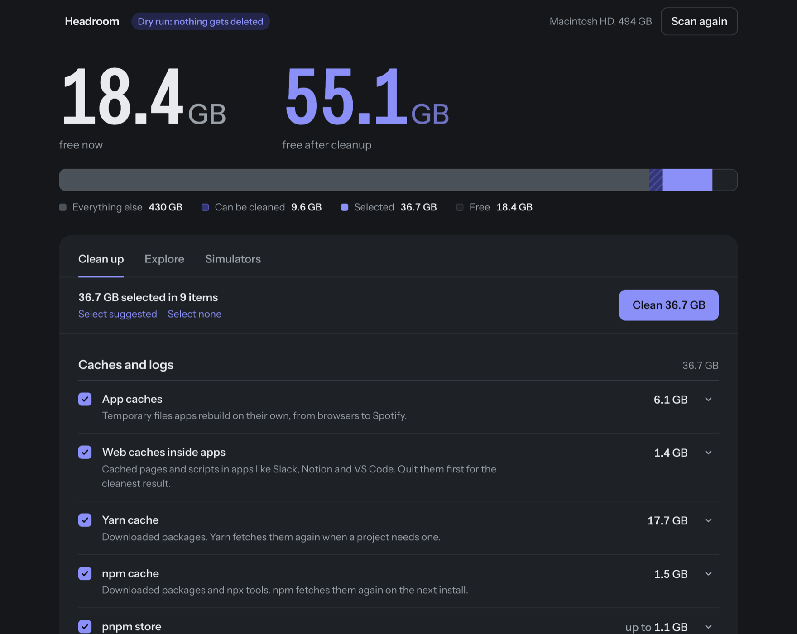

<p align="center">
  
</p>

<h1 align="center">Headroom</h1>

<p align="center">See what fills your Mac and clean the things that come back on their own.</p>

<p align="center">
  <a href="https://github.com/marvin-splitt/headroom/releases/latest"></a>
  <a href="https://github.com/marvin-splitt/headroom/actions/workflows/ci.yml"></a>
  
  <a href="LICENSE"></a>
</p>



Headroom measures caches, simulators, old project dependencies and downloads. It selects what is safe to
delete and cleans it with one button. It's free and open source, and it doesn't phone home.

## Install

1. Download the DMG for your Mac from the [latest release](https://github.com/marvin-splitt/headroom/releases/latest):
   `arm64` for Apple silicon (M1 and later), `x64` for Intel.
2. Open it and drag Headroom to Applications.

Headroom is signed with a Developer ID and notarized by Apple, so it opens like any other app. It needs
macOS 13 Ventura or later. Each release lists the SHA-256 checksums of its files in `SHA256SUMS.txt`.

### Full Disk Access

macOS hides the Trash and iPhone backups from apps by default. To measure and clean them, give Headroom
Full Disk Access in System Settings → Privacy & Security → Full Disk Access (Help → Open Full Disk Access
Settings takes you there). Everything else works without it.

### Build from source

You need Node.js 20 or later. Every release also has the source code attached as zip and tar.gz.

```sh
git clone https://github.com/marvin-splitt/headroom.git
cd headroom
npm install
npm run install-app   # builds Headroom.app for this Mac and copies it to /Applications
```

`npm run build` builds without installing; the app lands in `dist/`. Local builds are signed ad hoc, so
macOS asks for Full Disk Access again after each rebuild.

## What it does

- **Clean up** measures app and package manager caches, logs, Xcode build data, simulators and their
  runtimes, Docker leftovers, dependencies in projects you haven't touched in a while, the Trash and old
  installers. Safe items are selected for you; items marked *Review first* never are. One button cleans the
  selection.
- **Explore** lists any folder by size. Show it in Finder or move it to the Trash.
- **Simulators** erases or deletes simulators and old iOS runtimes.

To look around without deleting anything, start it in dry run mode: `open -a Headroom --args --dry-run`.

## Safety

- The window never sends paths to delete. It sends ids from the last scan, and the main process looks up
  what each id means.
- Every delete is checked against a guard. It refuses anything outside your home folder, symlink tricks,
  and protected places: Documents, Desktop, iCloud Drive, Mail, Messages, Photos, Keychains, `.ssh`.
- Clean up deletes permanently, because that's what frees the space. Explore moves things to the Trash.
- Running simulators and the runtimes they use are never touched. Docker volumes are never touched.
- Headroom may hold Full Disk Access, so the app binary can't be reused as a Node runtime or debugged
  through Node flags (Electron fuses), and the window runs sandboxed.

## Development

```sh
npm install
npm start       # run from source
npm run dry     # everything works, nothing is deleted
npm test        # safety tests against a throwaway home folder
```

- `electron/main.js` runs the scanning and cleaning code and opens the window.
- `electron/preload.cjs` is the window's only way to reach the disk: a short list of calls, no Node access.
- `lib/` measures and cleans: `scan.js` knows what to look for, `actions.js` deletes behind the guard,
  `core.js` ties them together.
- `renderer/` is the window itself, plain HTML, CSS and JavaScript loaded from an `app://` scheme with a
  strict content security policy. There is no build step.
- `test/` builds a fake home folder, tries to get the guard to delete things it shouldn't, then runs a quick
  cleanup and checks that only caches and build output are gone. The tests refuse to run unless `npm test`
  has pointed `HOME` at a temp folder.

See [CONTRIBUTING.md](CONTRIBUTING.md) for how to contribute and how releases are made.

## License

[MIT](LICENSE). The bundled Instrument Sans font is under the [SIL Open Font License](renderer/fonts/OFL.txt).
